# Vaultwarden Deployment on Nomad

A self-hosted Vaultwarden password manager deployed using HashiCorp Nomad and Docker, with persistent storage, HTTPS access through Nginx, secrets management, automated backups, and a tested recovery process.

## Project Overview

This project demonstrates how to deploy and manage Vaultwarden in a Nomad environment. It covers infrastructure preparation, service deployment, persistent storage, reverse-proxy configuration, application security, backup automation, and disaster recovery.

The deployment uses a Nomad development agent for the lab environment and a Docker container to run Vaultwarden.

## Architecture

The application follows this request flow:

```text
User Browser
     |
     | HTTPS
     v
Nginx Reverse Proxy
     |
     | HTTP - localhost:8080
     v
Vaultwarden Container
     |
     v
Persistent Host Volume
/opt/vaultwarden/data
     |
     v
SQLite Database and Vault Files
```

Nomad manages the Vaultwarden workload, while Consul is used as part of the lab environment.

## Technologies Used

| Technology | Purpose |
|---|---|
| HashiCorp Nomad | Container workload orchestration |
| HashiCorp Consul | Service discovery and infrastructure environment |
| Docker | Container runtime |
| Vaultwarden | Self-hosted password manager |
| Nginx | HTTPS reverse proxy |
| mkcert | Local TLS certificate generation |
| SQLite | Application database |
| Bash | Backup automation |
| Cron | Scheduled backups |
| Git and GitHub | Version control and project hosting |
| WSL2 / Ubuntu 24.04 | Linux development environment |

## Project Structure

```text
vaultwarden-nomad/
├── README.md
├── .gitignore
├── backups/
│   └── .gitkeep
├── docs/
│   ├── architecture.md
│   ├── backup-restore.md
│   ├── references.md
│   ├── security.md
│   └── screenshots/
├── nginx/
│   └── vaultwarden.conf
├── nomad/
│   └── vaultwarden.nomad
└── scripts/
    └── backup-vaultwarden.sh
```

Actual backup archives, application databases, private keys, and secrets are excluded from Git.

## Prerequisites

- Windows 11 with WSL2.
- Ubuntu 24.04.
- Docker Desktop with WSL integration.
- Nomad.
- Consul.
- Nginx.
- mkcert.
- Git.

## Deployment

### 1. Start the infrastructure

Start Docker Desktop and ensure its WSL integration is enabled.

Start the Consul agent and the Nomad development agent using the appropriate configuration for the lab environment.

Verify the Nomad node:

```bash
nomad node status
```

Verify Consul:

```bash
consul members
```

### 2. Configure persistent storage

Create the Vaultwarden data directory:

```bash
sudo mkdir -p /opt/vaultwarden/data
```

Configure the Nomad client host volume in `/etc/nomad.d/vaultwarden.hcl`:

```hcl
client {
  host_volume "vaultwarden-data" {
    path      = "/opt/vaultwarden/data"
    read_only = false
  }
}
```

The persistent directory ensures application data remains available when the container is restarted or replaced.

### 3. Configure secrets

The Vaultwarden admin token is stored as a Nomad Variable under:

`vaultwarden/admin`

The Nomad job retrieves the token through a template rather than exposing it directly in the job file.

Never commit the raw admin token or its hash to Git.

### 4. Deploy Vaultwarden

Submit the Nomad job:

```bash
nomad job run nomad/vaultwarden.nomad
```

Check the deployment:

```bash
nomad job status vaultwarden
```

Inspect the allocation:

```bash
nomad alloc status <allocation-id>
```

### 5. Configure HTTPS access

Nginx acts as the reverse proxy and forwards HTTPS requests to Vaultwarden on the local application port.

The local hostname used in this deployment is:

`https://vaultwarden.local`

A locally trusted certificate is generated using mkcert. The certificate and private key are stored outside the Git repository.

The Nginx configuration template is maintained in `nginx/vaultwarden.conf`.

### 6. Verify the application

Check the Vaultwarden health endpoint:

```bash
curl -i https://vaultwarden.local/alive
```

A successful response returns HTTP 200.

Verify that public registration is disabled:

```bash
curl -s https://vaultwarden.local/api/config
```

## Security Configuration

The deployment includes:

- Public user registration disabled.
- Invitations disabled.
- Admin token stored using Nomad Variables.
- HTTPS access through Nginx.
- Persistent application storage.
- Restricted permissions for backup and secret files.
- Container image pinned by digest.
- Sensitive application data excluded from Git.

Refer to [Security Documentation](docs/security.md) for additional details.

## Backup and Recovery

The backup script is located at:

`scripts/backup-vaultwarden.sh`

It performs the following operations:

- Creates a consistent SQLite database backup.
- Preserves the RSA key.
- Includes additional application data when present.
- Creates timestamped compressed archives.
- Applies restrictive file permissions.
- Removes archives older than the configured retention period.

Backups are stored locally under:

`/opt/vaultwarden/backups`

Automated backups are configured through cron.

A separate restore test was performed using an isolated Vaultwarden container and restored data directory. The recovered test account and its existing vault entry were successfully verified without overwriting the live Nomad deployment.

See [Backup and Recovery Documentation](docs/backup-restore.md).

## Verification Results

| Test | Result |
|---|---|
| Nomad workload deployment | Successful |
| Persistent storage configuration | Verified |
| HTTPS access | Successful |
| Public registration disabled | Verified |
| Vault entry persistence after restart | Successful |
| Automated backup execution | Verified |
| SQLite integrity check | Passed |
| Backup restoration | Successful |
| Recovered test account authentication | Successful |
| Recovered vault entry | Verified |

## Screenshots and Implementation Evidence

The following screenshots document the implementation from initial research through backup restoration.

### 1. Project Research and Preparation

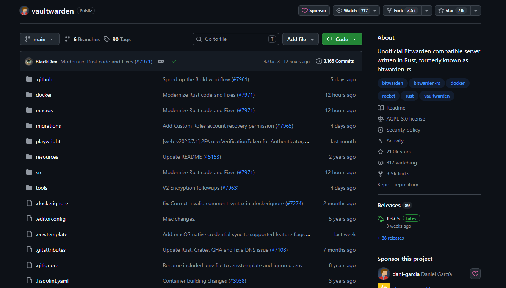

*Initial research and project preparation.*

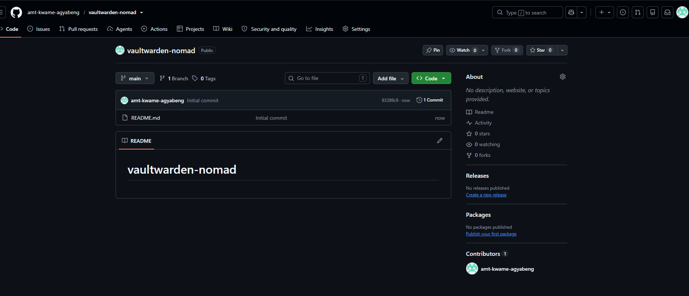

*GitHub repository created for the project.*

### 2. Nomad and Consul Environment

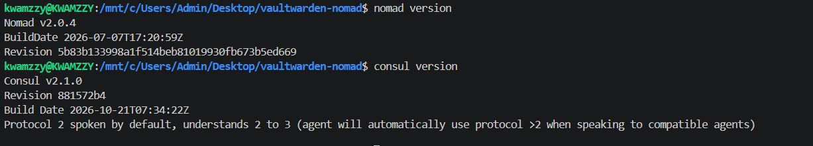

*Installed Nomad and Consul versions.*

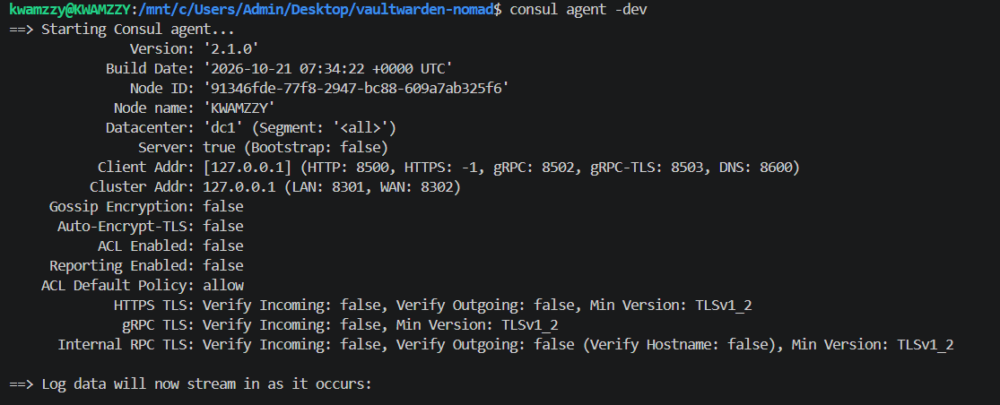

*Consul agent running.*

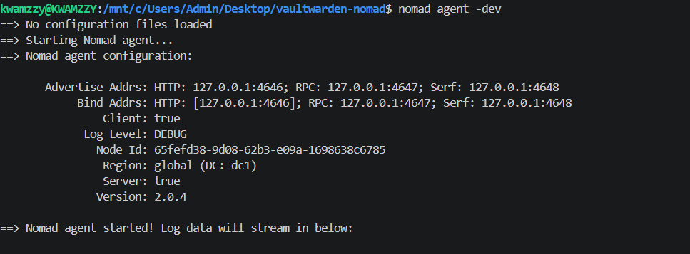

*Nomad agent running.*

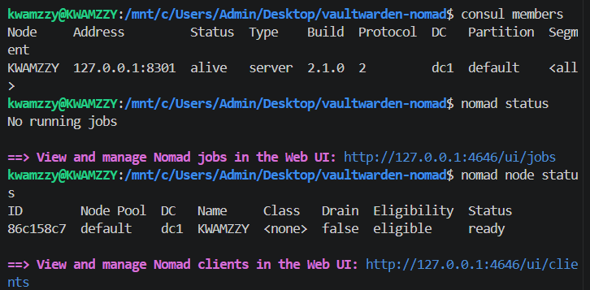

*Nomad and Consul environment ready for deployment.*

### 3. Vaultwarden Deployment

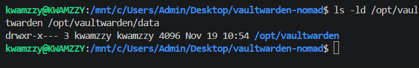

*Persistent storage configured for Vaultwarden.*

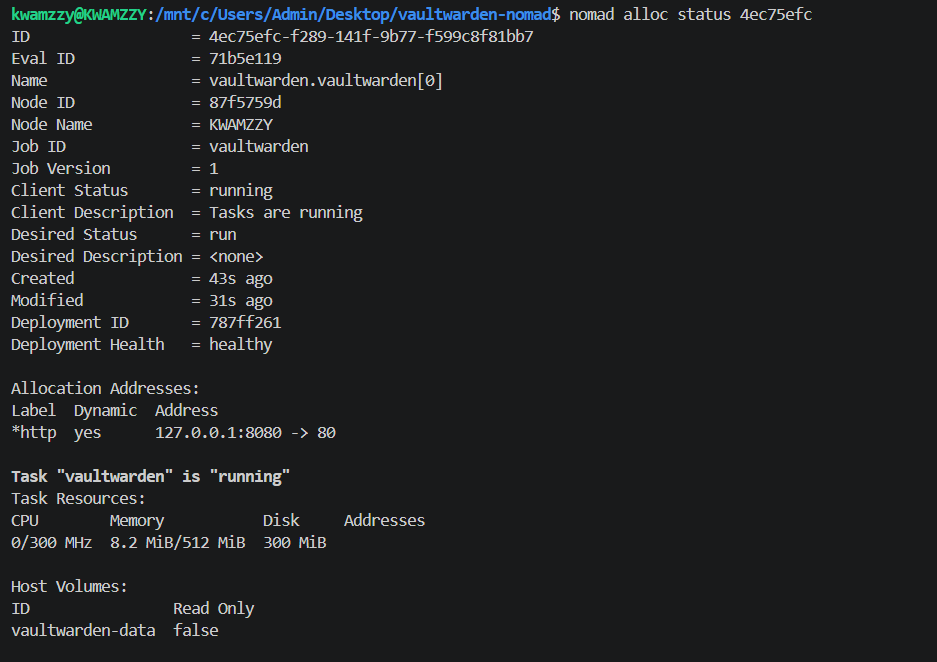

*Vaultwarden running as a Nomad allocation.*

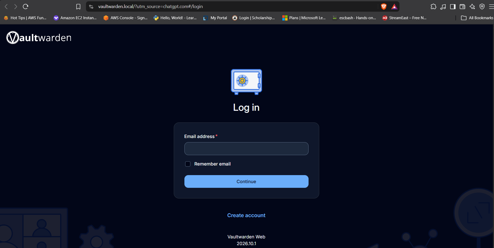

*Vaultwarden accessed through HTTPS.*


*Test vault entry created in the application.*

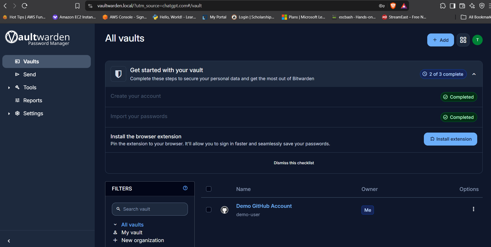

*Vault entry remains available after restarting the workload.*


*Admin page access restriction evidence.*

### 4. Backup and Recovery

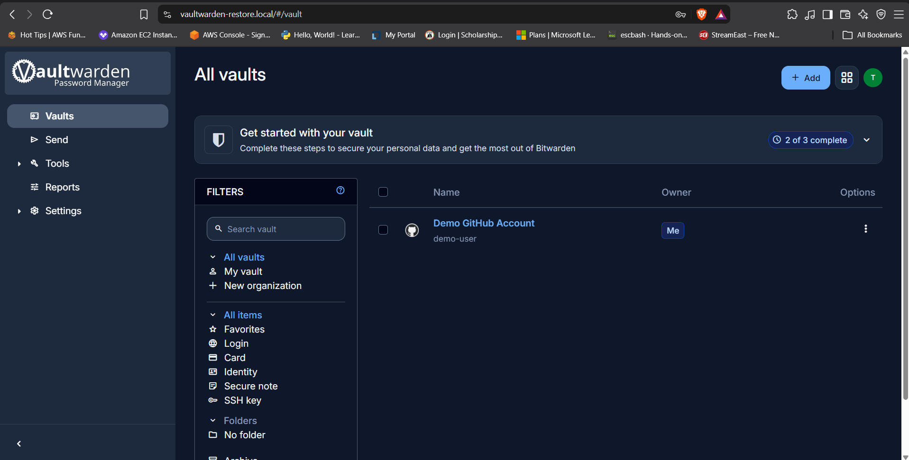

*Successful login to the restored instance with the previously backed-up vault entry.*

## Documentation

Additional project documentation:

- [Architecture](docs/architecture.md)
- [Security](docs/security.md)
- [Backup and Recovery](docs/backup-restore.md)
- [References](docs/references.md)

## Repository

GitHub: https://github.com/amt-kwame-agyabeng/vaultwarden-nomad

## Future Improvements

- Configure encrypted off-host backup storage.
- Introduce a longer backup retention policy for production use.
- Deploy Nomad in a production server cluster.
- Configure production-grade TLS and domain management.
- Introduce centralized monitoring and alerting.
- Implement automated backup restoration testing.

## Disclaimer

This project is intended for learning and demonstration purposes. A Nomad development agent and local certificates are used in the lab environment. Production deployments require additional high-availability, access-control, disaster-recovery, and security configurations.